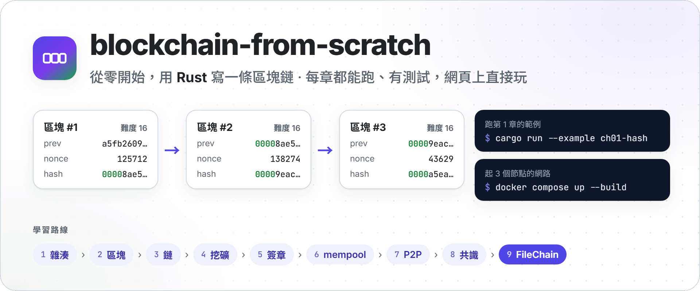
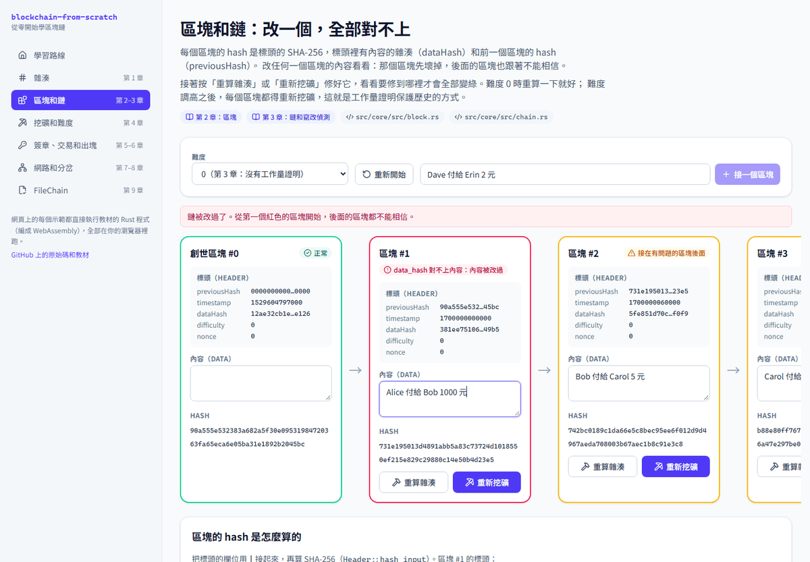
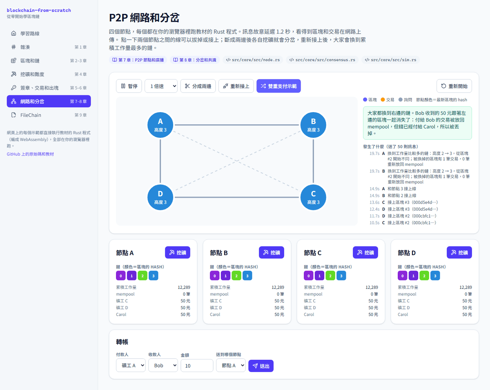
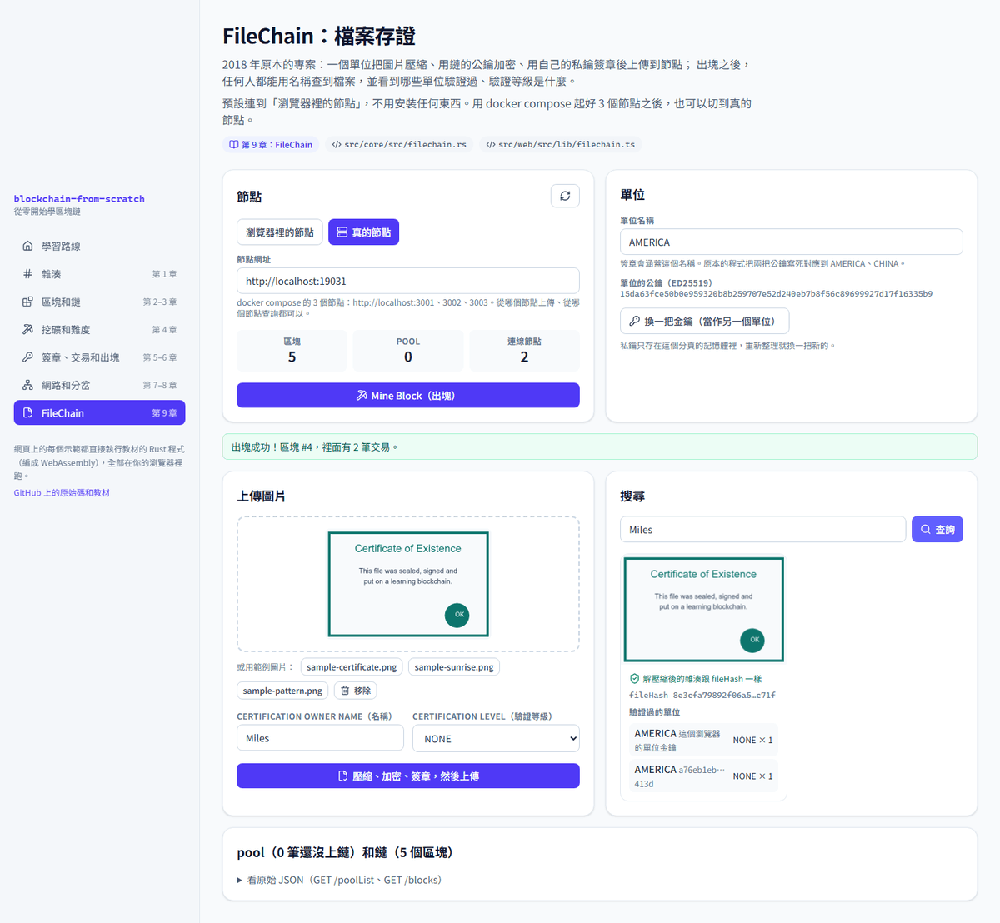
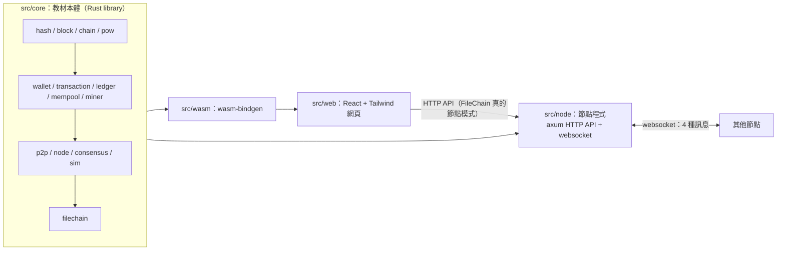

<p align="center">
  <picture>
    <source media="(prefers-color-scheme: dark)" srcset="docs/images/hero-dark.png">
    
  </picture>
</p>

<p align="center">
  <a href="https://github.com/NatLee/blockchain-from-scratch/actions/workflows/ci.yml"></a>
  
  
  <a href="LICENSE"></a>
</p>

**blockchain-from-scratch** 是一份從零開始寫區塊鏈的教材。九個章節，從雜湊一路做到會廣播、會分岔、會自己收斂的 P2P 網路，最後做出一個檔案存證系統（FileChain）。
每一章都有可以跑的 Rust 程式、測試和「動手做」的練習；互動網頁把同一份 Rust 程式編成 WebAssembly，讓你在瀏覽器裡直接看到雪崩效應、挖礦、竄改偵測和分岔。

**適合誰**：寫過一點程式、想搞懂區塊鏈底層到底在做什麼的人。剛學 Rust 也可以：程式註解會說明所有權、借用和 async 這些 Rust 特有的地方，但重點是區塊鏈，不是 Rust 教學。不需要密碼學背景。

## 怎麼開始

三種方式，挑一個：

1. **用互動網頁**：`docker compose up --build`，打開 <http://localhost:8080>。不想裝 Docker 的話，見[開發](#開發)用 `npm run dev`。
2. **跑每一章的範例**：[安裝 Rust](https://www.rust-lang.org/tools/install)（1.89 以上）之後：

   ```sh
   git clone https://github.com/NatLee/blockchain-from-scratch.git
   cd blockchain-from-scratch
   cargo run --example ch01-hash
   ```

3. **起一個 3 節點的網路**：`docker compose up --build`，3 個節點在 `localhost:3001`、`3002`、`3003`，見 [3 個節點的網路](#3-個節點的網路)。

建議的讀法：照章節順序讀 [`docs/chapters/`](docs/chapters/)，每章讀完跑那一章的範例、打開對應的網頁玩一下，再做「動手做」。

## 學習路線

| 章 | 主題 | 你會學到 | 程式 | 範例 |
|---|---|---|---|---|
| 1 | [雜湊](docs/chapters/01-hash.md) | SHA-256、雪崩效應 | [`hash.rs`](src/core/src/hash.rs) | `ch01-hash` |
| 2 | [區塊](docs/chapters/02-block.md) | 標頭和內容、創世區塊 | [`block.rs`](src/core/src/block.rs) | `ch02-block` |
| 3 | [鏈和竄改偵測](docs/chapters/03-chain.md) | 改一個區塊，後面全部對不上 | [`chain.rs`](src/core/src/chain.rs) | `ch03-chain` |
| 4 | [工作量證明和難度](docs/chapters/04-proof-of-work.md) | 挖礦、難度調整、累積工作量 | [`pow.rs`](src/core/src/pow.rs) | `ch04-pow` |
| 5 | [金鑰、簽章和交易](docs/chapters/05-signatures.md) | Ed25519 簽章、轉帳交易 | [`wallet.rs`](src/core/src/wallet.rs)、[`transaction.rs`](src/core/src/transaction.rs) | `ch05-signature` |
| 6 | [mempool 和出塊](docs/chapters/06-mempool.md) | 帳本、雙重支付、出塊獎勵 | [`ledger.rs`](src/core/src/ledger.rs)、[`mempool.rs`](src/core/src/mempool.rs)、[`miner.rs`](src/core/src/miner.rs) | `ch06-mempool` |
| 7 | [P2P 節點和廣播](docs/chapters/07-p2p.md) | 四種訊息、轉傳、補齊鏈 | [`p2p.rs`](src/core/src/p2p.rs)、[`node.rs`](src/core/src/node.rs)、[`src/node`](src/node/) | `ch07-p2p` |
| 8 | [分岔和共識](docs/chapters/08-consensus.md) | 累積工作量、重組、雙重支付 | [`consensus.rs`](src/core/src/consensus.rs) | `ch08-fork` |
| 9 | [FileChain](docs/chapters/09-filechain.md) | 壓縮、混合加密、簽章、上鏈、查詢、驗證等級 | [`filechain.rs`](src/core/src/filechain.rs) | `ch09-filechain` |

範例用 `cargo run --example <名稱>` 執行；挖礦的章節加 `--release` 會快很多。每章的「動手做」解答都在 [`src/core/tests/exercises.rs`](src/core/tests/exercises.rs)，而且有測試。

## 互動網頁

網頁上的每個示範都直接執行教材的 Rust 程式（編成 WebAssembly），全部在瀏覽器裡跑：

| 竄改一個區塊，後面全部不能相信 | 網路斷成兩邊，各自出塊，重新接上後收斂 |
|---|---|
|  |  |

FileChain 頁可以連到「瀏覽器裡的節點」，也可以連到 docker compose 起的真的節點：



## 架構



`src/core` 不碰網路、也不讀系統時鐘（時間由呼叫的人傳進來），所以同一份程式可以跑在節點程式、瀏覽器和測試裡。
節點的邏輯（收到訊息要回什麼、要廣播什麼）也在 core 裡，`src/node` 只負責把訊息真的送出去。

## 3 個節點的網路

```sh
docker compose up --build
```

會起 3 個節點和網頁：

| 服務 | 網址 | 說明 |
|---|---|---|
| node1 | <http://localhost:3001> | |
| node2 | <http://localhost:3002> | 啟動時連 node1（`PEERS=ws://node1:3001`） |
| node3 | <http://localhost:3003> | 啟動時連 node1、node2 |
| web | <http://localhost:8080> | 互動網頁 |

port 被占用時可以換：`NODE1_PORT=13001 WEB_PORT=18080 docker compose up --build`。3 個節點共用一把 FileChain 的鏈金鑰（存在 docker volume `chain-key`），跟原本的專案一樣，從任何節點都查得到解密後的檔案。

試幾個 API：

```console
$ curl http://localhost:3001/peers
["172.27.0.4:48042","172.27.0.5:47314"]

$ curl http://localhost:3003/getPublicKey
{"public_key":"541d5be819136cf2a4ba37bd5420a79c50d9d841070c58b92b4749cd51c6db35"}

$ curl -X POST http://localhost:3002/mineBlock
{"status":false,"message":"No data can be packed into block"}
```

pool 是空的時候不出塊（沿用原本 API 的規則）。上傳檔案要先壓縮、加密、簽章，用網頁的 FileChain 頁，或用命令列客戶端（原本 notebook 的流程）：

```sh
cargo run -p chain-node --example ch09-client -- http://localhost:3001 docs/images/samples Low AMERICA
```

不用 Docker 也可以直接跑節點，環境變數跟原本的專案一樣：

```sh
PORT=3001 cargo run -p chain-node
PORT=3002 PEERS=ws://localhost:3001 cargo run -p chain-node
```

| 環境變數 | 預設 | 說明 |
|---|---|---|
| `PORT` | `3001` | HTTP API 和 websocket 的 port |
| `PEERS` | （空） | 啟動時要連的節點，用逗號分隔，例如 `ws://localhost:3001,ws://localhost:3002` |
| `CHAIN_KEY_FILE` | `data/chain-key.hex` | FileChain 鏈金鑰的位置，不存在就產生一把 |
| `INITIAL_DIFFICULTY` | `16` | 第 1 個區塊的難度；同一個網路的節點要一樣 |
| `BIND` | `0.0.0.0` | 要聽的網路介面 |

## HTTP API

原本的 8 個 API 都在，路徑和參數都沒變：

| 方法 | 路徑 | 做什麼 |
|---|---|---|
| `GET` | `/blocks` | 整條鏈 |
| `POST` | `/mineBlock` | 把 pool 打包成新區塊（做工作量證明）；pool 是空的回 `{"status": false, "message": "No data can be packed into block"}` |
| `GET` | `/peers` | 連線中的節點 |
| `POST` | `/addPeer` | 連到新的節點：`{"peer": "ws://localhost:3002"}` |
| `POST` | `/addData` | FileChain：上傳一筆檔案存證（`base64Data`、`signature`、`public_key`、`certificateOwner`、`fileHash`、`cerLevel`、`unitName`、`timestamp`） |
| `GET` | `/queryBlockByName?queryName=…` | FileChain：用名稱查檔案，回傳解密後的檔案和驗證過的單位 |
| `GET` | `/poolList` | 還沒上鏈的交易（mempool） |
| `GET` | `/getPublicKey` | FileChain：鏈的加密公鑰 |

新增的：`POST /addTransaction`（任何簽好的交易，例如轉帳）、`GET /balances`（餘額），以及 `GET /`（節點資訊；websocket 請求則升級成節點之間的連線，跟原本一樣用 `/`）。
跟原本的格式不一樣的地方（例如 `/queryBlockByName` 的回應），見 [跟 2018 年原本專案的對應](docs/original-project.md)。

> 這是學習用的節點：沒有登入，任何網頁都可以呼叫它的 API（CORS 全開，方便網頁連到你電腦上的節點）。不要把它開在公開的網路上。

## 專案結構

```text
.
├── Cargo.toml              Rust workspace
├── docker-compose.yml      3 個節點 + 網頁
├── docs/
│   ├── chapters/           九章教材
│   ├── original-project.md 跟 2018 年原本專案的對應
│   └── images/             封面、截圖、範例圖片（自己做的）
└── src/
    ├── core/               教材本體：每章一個 module、examples/、tests/
    ├── node/               節點程式（axum + websocket）
    ├── wasm/               把 core 編成 WebAssembly
    └── web/                React + Tailwind 互動網頁
```

## 開發

Rust（core、節點）：

```sh
cargo fmt --all --check
cargo clippy --workspace --all-targets -- -D warnings
cargo test --workspace      # 每章的邏輯、練習解答、3 個節點的整合測試
```

網頁要先把 core 編成 WebAssembly。需要 `rustup target add wasm32-unknown-unknown` 和版本跟 `Cargo.lock` 一樣的 `wasm-bindgen-cli`（`src/web/scripts/build-wasm.sh` 會檢查並告訴你要裝哪一版）：

```sh
cd src/web
npm ci
npm run wasm      # 輸出到 src/web/src/wasm-pkg/
npm test          # vitest：核心綁定、FileChain 流程、模擬網路、每一頁
npm run dev       # http://localhost:5173
```

對真的節點跑端對端測試：先 `docker compose up -d`，再 `NODE_URLS=http://localhost:3001,http://localhost:3002,http://localhost:3003 npm run test:e2e`。

CI（GitHub Actions）會跑以上全部，另外用 docker compose 起 3 個節點，檢查每個 API、跑網頁的端對端測試和命令列客戶端。

## 金鑰和安全

- 節點的金鑰都在執行時產生：礦工錢包每次啟動產生一把（只在記憶體裡），FileChain 的鏈金鑰第一次啟動時產生並存檔。repo 裡沒有、也不應該有任何私鑰；`.gitignore` 擋住了 `data/`、`*.hex`、`*.pem`、`*.key`、`.env`。
- 密碼學全部用維護中的 crate：`sha2`、`ed25519-dalek`、`x25519-dalek`、`hkdf`、`aes-gcm`，沒有自己實作。
- 這是教材，不是可以上線的區塊鏈：沒有持久化（節點重啟後鏈就清空，跟原本的專案一樣）、沒有手續費、沒有防止大量垃圾交易的機制。

## 跟原本的專案和致謝

這個 repo 原本是 2018 年的課堂專案 `SW-Project01`，由 NatLee 和 [acute0203](https://github.com/acute0203) 一起完成：一個 Django 圖片上傳網站，加上參考 [koshikraj/pynaivechain](https://github.com/koshikraj/pynaivechain)（Apache-2.0，[lhartikk/naivechain](https://github.com/lhartikk/naivechain) 的 Python 版）改寫的區塊鏈節點。
FileChain 的客戶端流程、`cerLevel` 驗證等級和「Mine Block」按鈕都是 acute0203 做的，第 9 章就是從這個設計出發。

2026 年改寫成這份教材：程式是用 Rust 從頭重寫的，沒有沿用原本的程式碼；原本的每個功能都還在，對照和刻意改變的行為見 [跟 2018 年原本專案的對應](docs/original-project.md)。

## 授權

[MIT](LICENSE)
