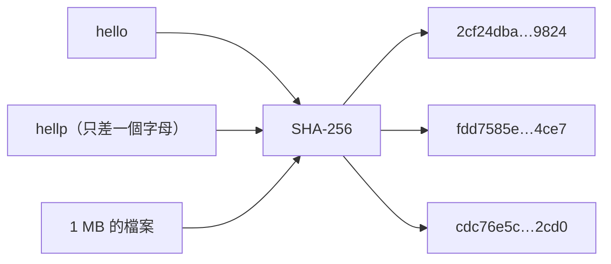

# 第 1 章：雜湊

這一章認識整條區塊鏈的地基：雜湊函式。讀完你會知道為什麼「改一個字，整條鏈都對不上」是做得到的。

- 程式：[`src/core/src/hash.rs`](../../src/core/src/hash.rs)
- 範例：`cargo run --example ch01-hash`
- 互動網頁：「雜湊」頁

## 雜湊是什麼

雜湊函式（hash function）把任何長度的資料，變成固定長度的一串數字，像是資料的指紋。
這個專案用的是 SHA-256，比特幣用的也是它。不管輸入是 5 個字還是 1 GB 的檔案，輸出都是 256 bit，寫成 64 個十六進位字元。



區塊鏈靠 SHA-256 的三個性質：

1. **確定**：同樣的輸入，永遠得到同樣的輸出。每個節點各自計算，答案都一樣。
2. **雪崩效應**：輸入只改一點點，輸出就面目全非，256 個 bit 裡平均有一半會翻轉。所以看雜湊猜不出輸入改了哪裡。
3. **單向、抗碰撞**：從輸出反推輸入幾乎不可能，要找到兩個不同的輸入有同樣的輸出也幾乎不可能。

第 3 章會用性質 1 和 2 偵測竄改，第 4 章的挖礦則用到性質 3：既然沒辦法反推，想要特定樣子的雜湊，就只能一直試。

## 看程式

整個 `hash.rs` 不到 60 行（不含測試）。最核心的兩個函式：

```rust
pub fn sha256(data: &[u8]) -> [u8; HASH_LEN] {
    Sha256::digest(data).into()
}

pub fn sha256_hex(data: &[u8]) -> String {
    hex::encode(sha256(data))
}
```

雜湊用的是維護中的 [`sha2`](https://crates.io/crates/sha2) crate。密碼學的東西不要自己寫：自己寫的版本很容易藏著看不出來的錯。

> **Rust 小提醒**：`data: &[u8]` 是「借用」一段 bytes。函式只能讀，不能改，也不會拿走呼叫者的資料，
> 所以呼叫完之後，你的資料還在你手上。回傳的 `[u8; 32]` 是固定長度的陣列，長度寫在型別裡，編譯器幫你保證永遠是 32 bytes。

另外兩個小工具後面會用到：

- `bit_difference(a, b)`：兩個雜湊有幾個 bit 不一樣。用 XOR（`^`）找出不同的 bit，再數有幾個 1。
- `leading_zero_bits(hash)`：開頭有幾個 0 bit。第 4 章的「難度」就是用它來算。

## 跑跑看

```console
$ cargo run --example ch01-hash
== 同樣的輸入，同樣的輸出；改一點點，完全不一樣 ==
   "hello" → 2cf24dba5fb0a30e26e83b2ac5b9e29e1b161e5c1fa7425e73043362938b9824
   "hello" → 2cf24dba5fb0a30e26e83b2ac5b9e29e1b161e5c1fa7425e73043362938b9824
   "hellp" → fdd7585e08c4e2afd71dcabdb4636c89d557a3f42db9e2040c8bbd1708aa4ce7
   "Hello" → 185f8db32271fe25f561a6fc938b2e264306ec304eda518007d1764826381969
  "hello " → 5e3235a8346e5a4585f8c58562f5052b8fe26a3bb122e1e96c76784964dfc461

== 雪崩效應："hello" 和 "hellp" 的前 32 個 bit ==
hello 00101100111100100100110110111010
hellp 11111101110101110101100001011110
      ^^ ^   ^  ^  ^ ^   ^ ^ ^^^^  ^
整個 256 bit 裡有 131 個不一樣（51%），理論上平均是一半。
```

打開互動網頁的「雜湊」頁，在兩個輸入框裡打字，可以看到 256 個 bit 即時翻轉。

## 動手做

**練習 1：挖礦預告。** 找一個最小的數字 `nonce`，讓 `sha256("hello" + nonce)` 的十六進位開頭是 `00`。大概要試幾次？

<details>
<summary>解答</summary>

<!-- solution -->
```rust
pub fn find_nonce(message: &str, zeros: usize) -> (u64, String) {
    let prefix = "0".repeat(zeros);
    (0u64..)
        .map(|nonce| (nonce, sha256_hex(format!("{message}{nonce}").as_bytes())))
        .find(|(_, hash)| hash.starts_with(&prefix))
        .expect("an infinite range always finds one eventually")
}
```

開頭 2 個十六進位的 0 就是 8 個 0 bit，每次嘗試成功的機率是 1/256，所以平均要試 256 次左右。
這就是第 4 章挖礦的全部祕密。

</details>

**練習 2：雪崩效應有多穩定？** 算 `"0"` 和 `"1"`、`"1"` 和 `"2"`……一直到 1000 組相鄰數字的雜湊，平均差幾個 bit？

<details>
<summary>解答</summary>

<!-- solution -->
```rust
pub fn average_bit_difference(samples: u32) -> f64 {
    let total: u32 = (0..samples)
        .map(|i| {
            bit_difference(
                &sha256(i.to_string().as_bytes()),
                &sha256((i + 1).to_string().as_bytes()),
            )
        })
        .sum();
    f64::from(total) / f64::from(samples)
}
```

結果非常接近 128（256 的一半）。輸入多像都沒用，輸出看起來就像隨機的。

</details>

兩題的解答和測試都在 [`src/core/tests/exercises.rs`](../../src/core/tests/exercises.rs)（`mod ch01`），執行 `cargo test --test exercises`。

## 重點整理

- SHA-256 把任何資料變成 32 bytes 的指紋：確定、雪崩、單向。
- 改一個字，大約一半的 bit 會翻轉，所以雜湊一比就知道資料有沒有被改過。
- 想找「長得像某個樣子」的雜湊，只能一直試，沒有捷徑。

下一章：[第 2 章：區塊](02-block.md)
