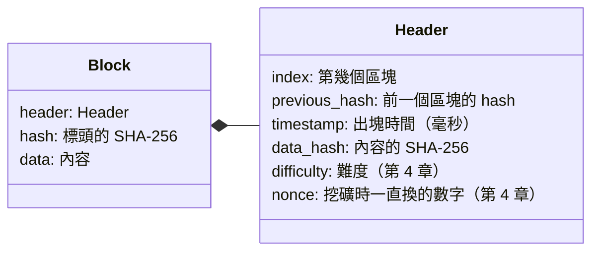

# 第 2 章：區塊

這一章做出區塊：把要記錄的資料，和證明資料沒被改過的資訊包在一起。

- 程式：[`src/core/src/block.rs`](../../src/core/src/block.rs)
- 範例：`cargo run --example ch02-block`
- 互動網頁：「區塊和鏈」頁

## 區塊長什麼樣子

一個區塊分成兩部分：**標頭**（header）和**內容**（data）。



區塊的 `hash` 只算標頭，不直接算內容。內容的指紋（`data_hash`）放在標頭裡，所以內容改一個字，`data_hash` 就變，`hash` 也跟著變。

為什麼要繞這一圈？因為第 4 章挖礦要算幾百萬次雜湊。如果每次都要把整個內容（可能是好幾 MB 的檔案）重算一次，會慢到不能用；
只算一小段固定長度的標頭就快多了。比特幣也是這樣做，它的標頭只有 80 bytes。

## 看程式

標頭要拿去雜湊的字串，就是把每個欄位用 `|` 接起來：

```rust
pub fn hash_input(&self) -> String {
    format!(
        "{}|{}|{}|{}|{}|{}",
        self.index, self.previous_hash, self.timestamp,
        self.data_hash, self.difficulty, self.nonce
    )
}
```

中間要有分隔符號。不然編號 `1` 加時間 `23…`，跟編號 `12` 加時間 `3…`，會接成同一個字串、得到同一個雜湊。

內容的雜湊是先把內容轉成 JSON，再算 SHA-256（`data_hash`）。`Block<D>` 的 `D` 是泛型（generic）：
前幾章的內容是一段文字（`Block<String>`），第 5 章開始換成一串交易（`Block<Vec<Transaction>>`），區塊和鏈的程式完全不用改。

> **Rust 小提醒**：`Block::new(…, data: D)` 的 `data` 沒有 `&`，代表函式會「拿走」內容的所有權（ownership）。
> 呼叫之後內容就屬於這個區塊，原本的變數不能再用。這樣區塊不會跟別人共用同一份內容，也就不會被別人偷偷改掉。
> 需要修改時用 `rehash(&mut self)`：`&mut` 是「可變借用」，可以改，但不會拿走。

**創世區塊**（genesis block）是第 0 個區塊，前面沒有區塊，`previous_hash` 用 64 個 0。每個節點都用一模一樣的創世區塊，
時間固定在 2018-06-22 02:13:17（UTC+8），也就是這個專案第一個 commit 的時間。

## 跑跑看

```console
$ cargo run --example ch02-block
== 區塊的雜湊只算標頭 ==
要雜湊的字串：1|90a555e532383a682a5f30e09531984720363fa65eca6e05ba31e1892b2045bc|1700000000000|381ee75106b819e04e23e2f10cf022248b977309faeadbd1b56fe4c47b5349b5|0|0
區塊雜湊：    731e195013d4891abb5a83c73724d1018550ef215e829c29880c14e50b4d23e5

== 內容改一個字，data_hash 和區塊雜湊都會變 ==
原本 data_hash：381ee75106b819e04e23e2f10cf022248b977309faeadbd1b56fe4c47b5349b5
改後 data_hash：f08308d0f360cc4e95ff229ac06787df8789114f94fb03ab3cf3db52f8c0f56b
原本 hash：     731e195013d4891abb5a83c73724d1018550ef215e829c29880c14e50b4d23e5
改後 hash：     6ba976ea45c3be41a06984af53d07cad8e421bc1914ab42b765d85c8ce0c006b
```

範例最後會印出區塊的 JSON，節點之間傳的就是這個格式（標頭的欄位攤平在區塊裡）。

## 動手做

**練習 1：** 同樣兩筆資料，交換順序之後 `data_hash` 一樣嗎？為什麼這很重要？

<details>
<summary>解答</summary>

<!-- solution -->
```rust
pub fn order_matters() -> bool {
    let ab = vec![
        "Alice pays Bob 10".to_string(),
        "Bob pays Carol 5".to_string(),
    ];
    let ba = vec![ab[1].clone(), ab[0].clone()];
    data_hash(&ab) != data_hash(&ba)
}
```

不一樣。順序也是內容的一部分：「先付錢再收錢」和「先收錢再付錢」可能一個合法、一個不合法（第 6 章的餘額檢查），所以順序被改也要看得出來。

</details>

**練習 2：** 把區塊的時間加 1 毫秒，區塊雜湊有幾個 bit 不一樣？

<details>
<summary>解答</summary>

<!-- solution -->
```rust
pub fn one_millisecond_difference() -> u32 {
    let a = Block::new(1, "00".repeat(32), super::START, 0, "data".to_string());
    let mut b = a.clone();
    b.header.timestamp += 1;
    b.rehash();
    bit_difference(
        &hex::decode(&a.hash).unwrap(),
        &hex::decode(&b.hash).unwrap(),
    )
}
```

大約一半（128 個左右）。標頭的每個欄位都受到雪崩效應保護。

</details>

解答和測試：[`src/core/tests/exercises.rs`](../../src/core/tests/exercises.rs)（`mod ch02`）。

## 重點整理

- 區塊 = 標頭 + 內容；區塊的 hash 只算標頭，標頭裡有內容的雜湊。
- 標頭的欄位要有分隔符號，雜湊才不會撞在一起。
- 創世區塊是大家約定好、完全一樣的第 0 個區塊。

下一章：[第 3 章：鏈和竄改偵測](03-chain.md)
