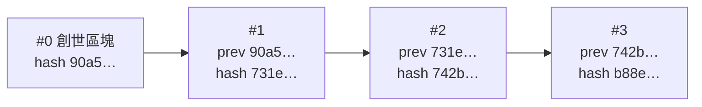

# 第 3 章：鏈和竄改偵測

這一章把區塊串成鏈，並寫出檢查整條鏈的程式。讀完你會看到「改一個區塊，後面全部對不上」是怎麼發生的，也會發現光靠雜湊還不夠。

- 程式：[`src/core/src/chain.rs`](../../src/core/src/chain.rs)
- 範例：`cargo run --example ch03-chain`
- 互動網頁：「區塊和鏈」頁（難度選 0）

## 鏈是怎麼串起來的

每個區塊的標頭都記著前一個區塊的 hash（`previous_hash`）。



假設有人偷改了區塊 1 的內容：

1. 區塊 1 的 `data_hash` 對不上內容，馬上被發現。
2. 他把區塊 1 的雜湊重算一次。區塊 1 看起來正常了，但它的 hash 變了，區塊 2 記的 `previous_hash` 就對不上。
3. 他只好把區塊 2 也改掉、重算……一路改到最後一個區塊。

只要從頭檢查一次，就知道有沒有人改過歷史。

## 看程式

檢查一個區塊能不能接在前面的區塊後面（`check_next`），依序檢查：

1. 內容和標頭有沒有被改過：重算 `data_hash` 和 `hash`，跟存著的比。
2. 編號是不是前一個加 1。
3. `previous_hash` 是不是前一個區塊的 hash。
4. 時間不能比前一個區塊早。
5. 難度和工作量證明（第 4 章才會用到，難度 0 時一定通過）。

`check_blocks` 從頭檢查整條鏈，回傳每個區塊的狀態：

```rust
pub enum BlockStatus {
    /// 這個區塊沒問題，前面的也都沒問題。
    Valid,
    /// 這個區塊本身有問題。
    Invalid(BlockError),
    /// 這個區塊本身沒問題，但它接在有問題的區塊後面，所以也不能相信。
    BuildsOnInvalid,
}
```

網頁就是用這個結果，把區塊塗成綠色、紅色和黃色。

`Blockchain<D>` 把區塊和規則參數包在一起，`push` 會先檢查，合格才接上。從別人那裡收到一整條鏈時，用 `Blockchain::from_blocks` 一次全部檢查，有問題會告訴你是第幾個區塊、什麼問題。

> **Rust 小提醒**：`check_next(prefix: &[Block<D>], block: &Block<D>, …)` 的 `&[Block<D>]` 是借用一段區塊（slice）。
> 檢查第 i 個區塊時傳 `&blocks[..i]`，只是看前面的區塊，不會複製整條鏈。

## 跑跑看

以下是輸出的節錄：

```console
$ cargo run --example ch03-chain
== 偷改區塊 1 的內容 ==
#0 ""               hash 90a555e53238…  ✅ 正常
#1 "Alice→Bob 1000" hash 21ed1a3dbf02…  ❌ data_hash 對不上內容：內容被改過
#2 "Bob→Carol 5"    hash 73a3d4345383…  ⚠️ 接在有問題的區塊後面
#3 "Carol→Dave 1"   hash 3e04f1bdf645…  ⚠️ 接在有問題的區塊後面

== 改完再重算區塊 1 的雜湊 ==
#1 "Alice→Bob 1000" hash 2ae04c544e97…  ✅ 正常
#2 "Bob→Carol 5"    hash 73a3d4345383…  ❌ previous_hash 對不上前一個區塊的 hash

== 把後面的區塊也全部重算 ==
#0 ""               hash 90a555e53238…  ✅ 正常
#1 "Alice→Bob 1000" hash 2ae04c544e97…  ✅ 正常
#2 "Bob→Carol 5"    hash 919575945fc1…  ✅ 正常
#3 "Carol→Dave 1"   hash ea458a9b4d07…  ✅ 正常

全部又「正常」了！重算雜湊太便宜，擋不住改歷史。第 4 章的工作量證明就是來解決這件事的。
```

注意最後一段：攻擊者把後面所有區塊都重算之後，整條鏈又合法了。電腦重算雜湊只要幾微秒，這擋不住任何人。

## 動手做

**練習 1：** 寫一個函式，找出第一個被改過（或接不上）的區塊。

<details>
<summary>解答</summary>

<!-- solution -->
```rust
pub fn first_bad_block(blocks: &[Block<String>], params: &ChainParams) -> Option<usize> {
    check_blocks(blocks, params)
        .iter()
        .position(|status| *status != BlockStatus::Valid)
}
```

</details>

**練習 2：** 當一次攻擊者：改掉第 `index` 個區塊的內容，再把它和後面的區塊全部重新接好、重算雜湊。檢查程式抓得到嗎？

<details>
<summary>解答</summary>

<!-- solution -->
```rust
pub fn rewrite_history(
    blocks: &[Block<String>],
    index: usize,
    data: &str,
) -> Vec<Block<String>> {
    let mut forged = blocks.to_vec();
    forged[index].data = data.to_string();
    for i in index..forged.len() {
        forged[i].header.previous_hash = forged[i - 1].hash.clone();
        forged[i].rehash();
    }
    forged
}
```

難度 0 時抓不到：偽造的鏈每一個區塊都接得上。這就是下一章要解決的問題。

</details>

解答和測試：[`src/core/tests/exercises.rs`](../../src/core/tests/exercises.rs)（`mod ch03`）。

## 重點整理

- 每個區塊記著前一個區塊的 hash，改一個區塊，從它開始後面全部接不上。
- 從頭檢查一次就能找出第一個有問題的區塊。
- 可是攻擊者可以把後面的區塊全部重算，光靠雜湊擋不住。

下一章：[第 4 章：工作量證明和難度](04-proof-of-work.md)
