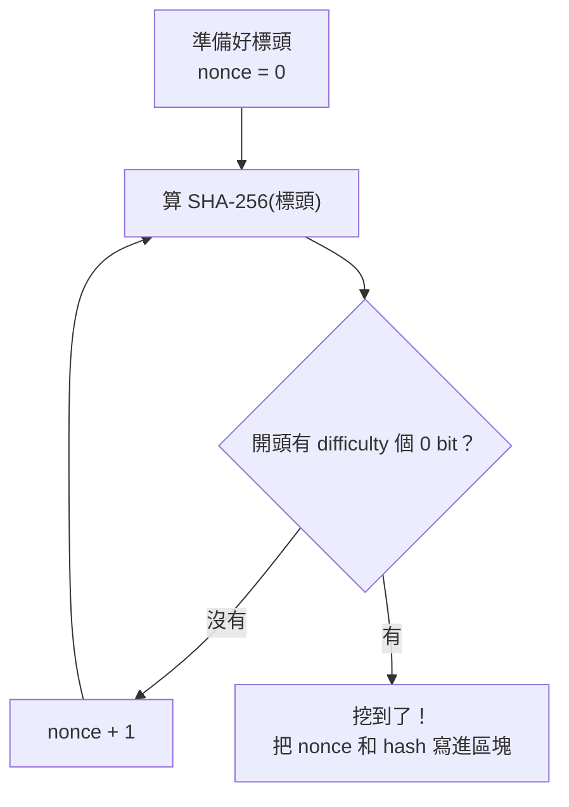

# 第 4 章：工作量證明和難度

上一章的鏈有個漏洞：改了歷史之後，只要把後面的區塊全部重算，鏈又合法了。這一章用工作量證明（proof of work）讓「重算」變得非常昂貴。

- 程式：[`src/core/src/pow.rs`](../../src/core/src/pow.rs)、[`src/core/src/params.rs`](../../src/core/src/params.rs)
- 範例：`cargo run --release --example ch04-pow`
- 互動網頁：「挖礦和難度」頁、「區塊和鏈」頁（難度選 12 或 16）

## 想法：讓雜湊很難算出來

規定：區塊的 hash 開頭至少要有 `difficulty` 個 0 bit，才算合格。

雜湊沒辦法預測（第 1 章），想得到合格的 hash，唯一的方法是一直換標頭裡的 `nonce`、一直算：



每試一次，成功的機率是 1/2^difficulty，所以難度 `d` 平均要試 `2^d` 次。難度每加 1，工作量就變兩倍。
驗證卻只要算一次：拿標頭算一次 SHA-256，看開頭有沒有夠多個 0。**很難做、很好驗**，這就是工作量證明。

現在攻擊者想改區塊 1，就得把區塊 1 和後面每一個區塊都重新挖一遍。如果全世界的礦工每 10 分鐘挖出一個區塊，
攻擊者要比全世界加起來還快，才追得上。

## 難度要能自動調整

電腦越來越快、礦工越來越多，固定的難度會讓區塊越出越快。所以難度要跟著出塊時間調整。這裡用跟 naivecoin 一樣簡單的規則（`next_difficulty`）：

- 第 1 個區塊用 `initial_difficulty`。
- 每 `adjustment_interval` 個區塊檢查一次：最近這段時間出塊太快（不到預期的一半）就加 1，太慢（超過預期的兩倍）就減 1。
- 難度不會超出 `min_difficulty`～`max_difficulty`。

這些規則參數放在 `ChainParams`。同一個網路的節點必須用同一組參數，否則會互相認為對方的區塊不合法。

比特幣的規則類似，但每 2016 個區塊（約兩週）調整一次，而且是按比例調整，一次最多 4 倍。

## 看程式

挖礦的核心只有幾行（`try_mine`）：

```rust
pub fn try_mine(header: &mut Header, max_attempts: u64) -> Option<String> {
    for _ in 0..max_attempts {
        let hash = sha256(header.hash_input().as_bytes());
        if leading_zero_bits(&hash) >= header.difficulty {
            return Some(hex::encode(hash));
        }
        header.nonce = header.nonce.wrapping_add(1);
    }
    None
}
```

一次最多試 `max_attempts` 次，沒找到就回傳 `None`，nonce 停在下一個要試的數字。網頁用這個函式分段挖礦，每段之間讓瀏覽器更新畫面，才不會卡住。

另外，`chain_work` 把每個區塊的 `2^difficulty` 加起來，叫做累積工作量。第 8 章決定要相信哪一條鏈時會用到。

> **Rust 小提醒**：`header: &mut Header` 讓函式可以直接改呼叫者的標頭（換 nonce），不用複製一份再傳回來。
> 同一時間只能有一個 `&mut` 借用，所以不會有兩段程式同時改同一個 nonce。

## 跑跑看

`--release` 讓編譯器最佳化，挖礦會快很多：

```console
$ cargo run --release --example ch04-pow
== 難度每加 1，平均要試的次數就變兩倍 ==
難度  4：試了        44 次（理論平均        16），    15.9µs，hash 080f71762be8592c…
難度  8：試了       129 次（理論平均       256），    42.1µs，hash 00a57dd9937b131b…
難度 12：試了       320 次（理論平均      4096），   108.9µs，hash 000b0e5512f47529…
難度 16：試了    266573 次（理論平均     65536），   205.1ms，hash 000037d7a0302949…
難度 20：試了    834840 次（理論平均   1048576），   790.1ms，hash 000002516490accb…

== 出塊太快，難度自動往上調 ==
每個區塊的難度：[8, 8, 8, 8, 8, 8, 8, 8, 8, 9, 9, 9, 9, 9, 10, 10, 10, 10, 10, 11]
累積工作量：約 12033 次雜湊
```

每次的次數都不一樣（運氣），但平均起來就是 2^難度。第二段模擬每 100 毫秒出一個區塊（目標是 1 秒），難度每 5 個區塊就往上調一次。

到互動網頁的「區塊和鏈」頁，把難度選成 12，竄改一個區塊再修好它：每個區塊都得重新挖礦，要修的區塊越多，等越久。

## 動手做

**練習 1：** 實際量量看：難度 6 平均要試幾次？

<details>
<summary>解答</summary>

<!-- solution -->
```rust
pub fn average_attempts(difficulty: u32, samples: u64) -> f64 {
    let total: u64 = (0..samples)
        .map(|i| {
            let block = Block::new(
                1,
                "00".repeat(32),
                super::START + i,
                difficulty,
                i.to_string(),
            );
            mine(block).1
        })
        .sum();
    total as f64 / samples as f64
}
```

挖 300 次的平均會落在 64（2^6）附近。

</details>

**練習 2：** 攻擊者想改第 `from` 個區塊，至少要重做多少工作量？越舊的區塊越難改嗎？

<details>
<summary>解答</summary>

<!-- solution -->
```rust
pub fn rewrite_cost<D>(blocks: &[Block<D>], from: usize) -> u128 {
    chain_work(&blocks[from..])
}
```

被改的區塊和它後面的區塊全部都要重挖，所以越舊的區塊，後面的區塊越多，越難改。這也是為什麼交易「上鏈之後再等幾個區塊」就更安全。

</details>

解答和測試：[`src/core/tests/exercises.rs`](../../src/core/tests/exercises.rs)（`mod ch04`）。

## 重點整理

- 工作量證明：區塊的 hash 開頭要有夠多個 0，只能靠一直試 nonce 找到。很難做、很好驗。
- 難度 `d` 平均要試 `2^d` 次；改歷史要把後面所有區塊重挖，越舊越難改。
- 難度跟著出塊時間自動調整，規則參數同一個網路要一樣。

下一章：[第 5 章：金鑰、簽章和交易](05-signatures.md)
