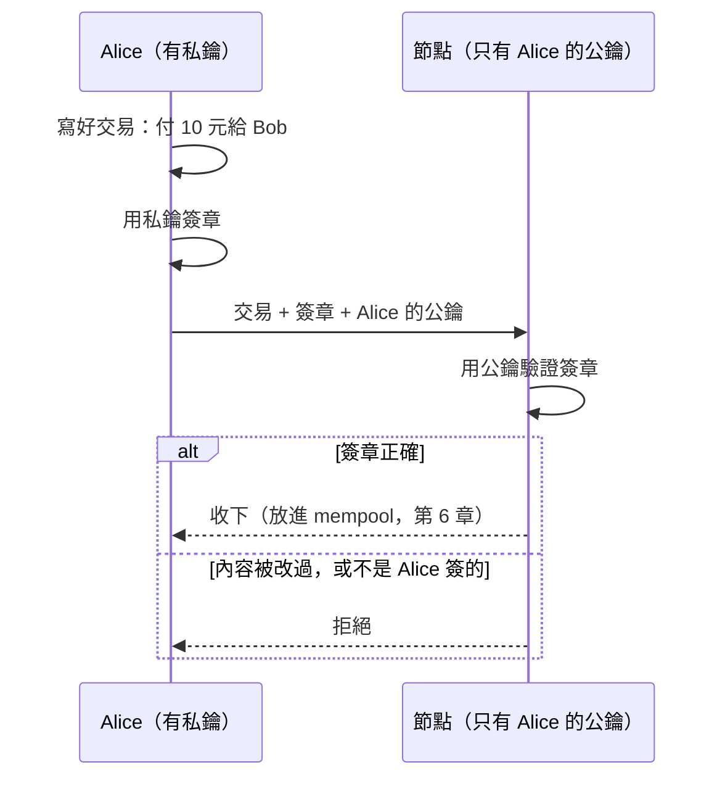

# 第 5 章：金鑰、簽章和交易

到目前為止，區塊裡的內容是誰都能寫的一段文字。這一章讓內容變成**交易**：只有錢的主人簽了章，交易才算數。

- 程式：[`src/core/src/wallet.rs`](../../src/core/src/wallet.rs)、[`src/core/src/transaction.rs`](../../src/core/src/transaction.rs)
- 範例：`cargo run --example ch05-signature`
- 互動網頁：「簽章、交易和出塊」頁

## 沒有帳號密碼，靠的是一對金鑰

區塊鏈上沒有「登入」。證明「這筆錢是我的」靠的是數位簽章，用一對金鑰：

- **私鑰**（secret key）：只有自己知道，用來簽章。
- **公鑰**（public key）：公開給大家，用來驗證簽章。這個專案直接把公鑰當成地址。



簽章有兩個保證：

1. **是本人**：沒有私鑰就簽不出能用公鑰驗證的簽章。
2. **沒被改**：簽章是針對整筆內容算的，金額、收款人、時間改了任何一個，驗證就失敗。

簽章用 Ed25519（[`ed25519-dalek`](https://crates.io/crates/ed25519-dalek) crate）：金鑰 32 bytes、簽章 64 bytes，速度快，而且沒有「選錯雜湊或填充方式」這類容易出錯的參數。

> **跟 2018 年原本的專案比**：原本用 RSA PKCS#1 v1.5 加 SHA-1 簽章，而且只簽了加密後的檔案。
> SHA-1 在 2017 年已經被做出碰撞，不適合再用來簽章；只簽檔案的話，名稱、等級這些欄位可以在傳送途中被改掉。
> 新版改用 Ed25519，簽整筆紀錄。

## 交易長什麼樣子

```json
{
  "type": "transfer",
  "body": {
    "to": "71d2df60…3163",
    "amount": 10,
    "timestamp": 1700000000000
  },
  "publicKey": "4df69ea1…c34a",
  "signature": "60930e38…4a0c"
}
```

- `body` 是要簽章的內容。付款人就是簽章的人（`publicKey`），所以 body 裡不用再寫付款人。
- `timestamp` 讓兩筆一模一樣的轉帳（同一個人、同樣金額、同一個收款人）變成不同的交易。
- 交易的編號（`id`）是整筆交易的 SHA-256。

交易有三種（`Transaction` enum）：轉帳（`transfer`）、出塊獎勵（`coinbase`，第 6 章）、檔案存證（`file`，第 9 章）。

## 看程式

簽章和驗證都是一行，難的部分交給 `ed25519-dalek`：

```rust
impl<T: Serialize> Signed<T> {
    pub fn sign(body: T, wallet: &Wallet) -> Self {
        let signature = wallet.sign(&signing_bytes(&body));
        Signed { body, public_key: wallet.address(), signature }
    }

    pub fn verify(&self) -> Result<(), TxError> {
        wallet::verify(&self.public_key, &signing_bytes(&self.body), &self.signature)
            .map_err(|_| TxError::BadSignature)
    }
}
```

要簽的 bytes 是 `body` 的 JSON。Rust 的 struct 轉 JSON 時欄位順序固定，所以簽的人和驗的人算出一模一樣的 bytes。
驗證用 `verify_strict`，多擋了幾種特殊的公鑰和簽章：區塊鏈上每個節點都要得到同樣的驗證結果，越嚴格越好。

> **Rust 小提醒**：`Wallet` 刻意不實作 `Debug` 和 `Serialize`，所以私鑰不會不小心被 `println!("{:?}")` 印出來，
> 也不會被序列化進 API 的回應。型別系統幫你守住私鑰。

## 跑跑看

以下是輸出的節錄，省略了中間印出的交易 JSON（格式見上一節）：

```console
$ cargo run --example ch05-signature
== Alice 簽了一筆轉帳 ==
驗證簽章：Ok(())
交易編號：651da77d012e3fa7b7eeaae16ee4db15a3c5fd68f017da1a8cec93ba761fb36e

== Mallory 把金額改成 1000 ==
驗證簽章：Err(BadSignature)

== Mallory 自己簽，卻把付款人寫成 Alice ==
驗證簽章：Err(BadSignature)
```

金鑰每次執行都是新產生的，所以你看到的地址和編號會不一樣。在互動網頁上可以直接改交易的 JSON，再按「驗證簽章」。

## 動手做

**練習 1：** Mallory 截到 Alice 給 Bob 的交易，把收款人改成自己。會成功嗎？

<details>
<summary>解答</summary>

<!-- solution -->
```rust
pub fn redirect(tx: &Transaction, to: &str) -> Transaction {
    let Transaction::Transfer(signed) = tx else {
        panic!("only transfers have a recipient");
    };
    let mut forged = signed.clone();
    forged.body.to = to.to_string();
    Transaction::Transfer(forged)
}
```

`verify_signature()` 回傳 `Err(BadSignature)`。收款人在 `body` 裡，被簽章保護。

</details>

**練習 2：** Mallory 改不了交易，那把 Alice 的交易**原封不動**再送一次呢？（重送攻擊，replay attack）

<details>
<summary>解答</summary>

簽章是對的，所以光看簽章擋不住。擋住它的是帳本：每筆上鏈的交易都會記下編號，同一個編號第二次出現就拒絕（`TxError::Duplicate`）。
Alice 真的想再轉一次時，換一個 `timestamp` 就是另一筆交易。測試見 `replaying_a_transaction_is_rejected`。

</details>

解答和測試：[`src/core/tests/exercises.rs`](../../src/core/tests/exercises.rs)（`mod ch05`）。

## 重點整理

- 私鑰簽章、公鑰驗證；地址就是公鑰。
- 簽章保護整筆內容：改了任何欄位，或不是本人簽的，驗證就失敗。
- 簽章擋不住原封不動的重送，要靠帳本記住已經處理過的交易。

下一章：[第 6 章：mempool 和出塊](06-mempool.md)
