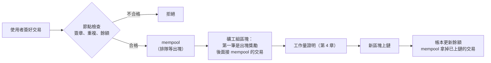

# 第 6 章：mempool 和出塊

有了交易，還要決定交易什麼時候、由誰寫進區塊。這一章做出交易的等候區（mempool）、算餘額的帳本，以及礦工的出塊獎勵。

- 程式：[`src/core/src/ledger.rs`](../../src/core/src/ledger.rs)、[`src/core/src/mempool.rs`](../../src/core/src/mempool.rs)、[`src/core/src/miner.rs`](../../src/core/src/miner.rs)
- 範例：`cargo run --example ch06-mempool`
- 互動網頁：「簽章、交易和出塊」頁的下半部

## 一筆交易從送出到上鏈



## 帳本：餘額是算出來的

區塊鏈本身只記「發生過哪些交易」，沒有存「每個人有多少錢」。餘額是從創世區塊開始，把每筆交易照順序套用一遍算出來的（`Ledger::from_blocks`）。套用的時候順便檢查：

- 簽章對不對（第 5 章）。
- 這筆交易是不是已經處理過（重送攻擊）。
- 付款人的錢夠不夠、金額是不是大於 0、收款地址的格式對不對。

錢從哪裡來？每個區塊的**第一筆**必須是給礦工的出塊獎勵（coinbase），金額固定是 `block_reward`（預設 50），而且只能放在第一筆。
這是新的錢進入系統的唯一方式，也是礦工願意花電費挖礦的原因。

## mempool：排隊中的交易也要算進去

交易送到節點之後，先放進 mempool 排隊，等礦工把它打包進區塊。放進來之前一樣要檢查，但有一個陷阱：

> Alice 只有 50 元。她同時送出兩筆轉帳，各 30 元。如果只看鏈上的餘額，兩筆都會通過檢查。

這就是**雙重支付**（double spending）。所以 mempool 檢查新交易時，會先把排隊中的交易也套用進去，再檢查新的這一筆（`pending_ledger`）。
第二筆 30 元看到的餘額只剩 20 元，被拒絕。

新區塊上鏈之後，mempool 用新的帳本重建一次：已經上鏈的交易變成「重複」而被拿掉，其他交易重新檢查。

## 看程式

礦工組區塊（`miner::assemble`）：

```rust
let height = chain.latest().header.index + 1;
let mut data = Vec::with_capacity(mempool.len() + 1);
data.push(Transaction::coinbase(miner, chain.params().block_reward, height));
data.extend(mempool.transactions().iter().cloned());
chain.next_block(timestamp, data)
```

出塊獎勵裡的 `height` 是區塊編號，讓每個區塊的獎勵交易編號都不一樣，才不會被當成重複。

> **Rust 小提醒**：`Mempool::add(&mut self, tx: Transaction, ledger: &Ledger)`。交易沒有 `&`，會被「搬進」mempool；
> 帳本是 `&`，只借來看。試算時用 `ledger.clone()` 複製一份帳本，在副本上套用排隊中的交易，原本的帳本完全不受影響。

## 跑跑看

```console
$ cargo run --example ch06-mempool
== Alice 挖到第 1 個區塊，拿到出塊獎勵 ==
試了 2224 次雜湊
Alice 的餘額：50

== Alice 同時送出兩筆 30 元的轉帳 ==
給 Bob：  Ok(New)
給 Carol：Err(InsufficientFunds { balance: 20, amount: 30 })
mempool 裡有 1 筆交易

== Bob 挖下一個區塊，把 mempool 的交易打包進去 ==
區塊 #2 有 2 筆交易（第一筆是出塊獎勵）
上鏈之後 mempool 剩 0 筆
 Alice：20
   Bob：80
```

Bob 的 80 元 = Alice 付的 30 元 + 他自己挖到區塊的出塊獎勵 50 元。錢包每次都是新產生的，所以「試了幾次雜湊」每次不一樣。

## 動手做

**練習 1：** 真的區塊鏈會限制每個區塊的大小。改寫組區塊的函式，每個區塊最多放 `max` 筆交易（不含出塊獎勵）。

<details>
<summary>解答</summary>

<!-- solution -->
```rust
pub fn assemble_limited(
    chain: &Blockchain<Vec<Transaction>>,
    mempool: &Mempool,
    miner: &str,
    timestamp: u64,
    max: usize,
) -> TxBlock {
    let height = chain.latest().header.index + 1;
    let mut data = vec![Transaction::coinbase(
        miner,
        chain.params().block_reward,
        height,
    )];
    data.extend(mempool.transactions().iter().take(max).cloned());
    chain.next_block(timestamp, data)
}
```

`take(max)` 只取前面 `max` 筆，剩下的留在 mempool 等下一個區塊。比特幣的礦工會優先挑手續費高的交易，這個專案沒有手續費，照收到的順序排。

</details>

**練習 2：** Alice 有 50 元，同時送出兩筆 30 元的轉帳，mempool 收幾筆？第二筆的錯誤訊息是什麼？

<details>
<summary>解答</summary>

收 1 筆。第二筆得到 `InsufficientFunds { balance: 20, amount: 30 }`：mempool 把第一筆排隊中的 30 元先扣掉了。測試見 `only_one_of_two_overlapping_payments_fits`。

</details>

解答和測試：[`src/core/tests/exercises.rs`](../../src/core/tests/exercises.rs)（`mod ch06`）。

## 重點整理

- 餘額是從頭重算整條鏈得到的；每個區塊第一筆是固定金額的出塊獎勵。
- 交易先進 mempool 排隊；檢查時要把排隊中的交易也算進去，才擋得住雙重支付。
- 新區塊上鏈後，mempool 拿掉已經上鏈的交易，其他重新檢查。

下一章：[第 7 章：P2P 節點和廣播](07-p2p.md)
