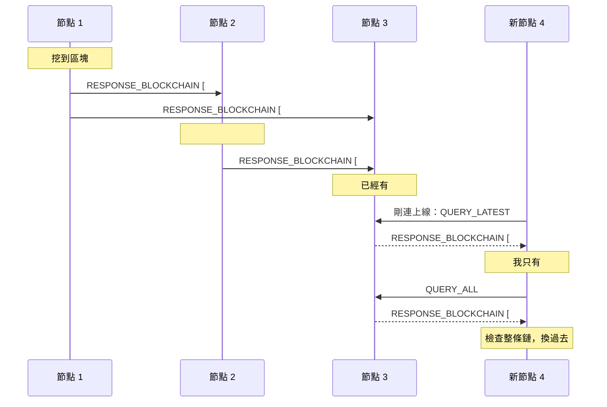

# 第 7 章：P2P 節點和廣播

區塊鏈沒有中央伺服器：每個節點都有一份完整的鏈，彼此直接傳訊息。這一章讓節點互相連線、轉傳交易和區塊，最後起一個真的 3 節點網路。

- 程式：[`src/core/src/p2p.rs`](../../src/core/src/p2p.rs)、[`src/core/src/node.rs`](../../src/core/src/node.rs)、[`src/core/src/sim.rs`](../../src/core/src/sim.rs)
- 節點程式：[`src/node/`](../../src/node/)（axum 提供 HTTP API，websocket 連節點）
- 範例：`cargo run --example ch07-p2p`；真的網路：`docker compose up --build`
- 互動網頁：「網路和分岔」頁

## 只有四種訊息

節點之間只傳四種訊息，跟 2018 年原本的專案（和它參考的 [naivechain](https://github.com/lhartikk/naivechain)）一樣：

| 訊息 | 意思 | 原本的名稱 |
|---|---|---|
| `QUERY_LATEST` | 你最新的區塊是哪個？ | `QUERY_LATEST = 0` |
| `QUERY_ALL` | 把你整條鏈給我 | `QUERY_ALL = 1` |
| `RESPONSE_BLOCKCHAIN` | 這是我的區塊（一個或整條） | `RESPONSE_BLOCKCHAIN = 2` |
| `BROADCAST_TRANSACTION` | 有一筆新交易 | `BROADCASTED_MESSAGE = 3` |

訊息用 JSON 傳，例如 `{"type":"QUERY_LATEST"}`。

## 一個新區塊怎麼傳遍網路



收到一個區塊時，節點這樣判斷（`Node::handle_blocks`）：

1. 已經有這個區塊了：不理它。這條規則讓訊息不會在網路裡無限繞圈。
2. 剛好接在我最新的區塊後面：檢查後接上，再告訴其他節點。
3. 編號比我新，但接不上：我落後了（或分岔了，第 8 章），回一個 `QUERY_ALL` 請對方給整條鏈。
4. 收到整條鏈：累積工作量比我多、而且全部合法，就換過去（第 8 章）。

新節點剛連上線時，先問對方 `QUERY_LATEST`。對方回最新的區塊，新節點發現自己落後，再要整條鏈，就這樣補齊。

交易也是一樣：節點收到一筆沒看過的交易，檢查後放進 mempool，再轉傳給其他節點；看過的就不轉傳。

## 把網路和邏輯分開

`Node`（core 裡）刻意不碰網路，也不看時鐘。收到訊息時呼叫 `handle`，它回傳「要回覆誰、要廣播什麼」：

```rust
pub enum Outbound {
    /// 只回給送訊息來的那個節點。
    Reply(Message),
    /// 送給所有連著的節點。
    Broadcast(Message),
}
```

真的把訊息送出去，是呼叫的人的事。這種寫法叫 sans-IO，同一份 `Node` 用在三個地方：

- `src/node`：真的節點程式，用 websocket 送訊息。
- `sim::Network`：記憶體裡的模擬網路，訊息延遲多久、哪條線斷掉都可以控制，測試每次跑的結果都一樣。
- 瀏覽器：互動網頁的「網路和分岔」頁跑的就是 `sim::Network`（編成 WebAssembly）。

## 真的節點程式

`src/node` 用 [axum](https://crates.io/crates/axum) 提供 HTTP API，原本的 8 個 API 都在（見 [README 的 HTTP API](../../README.md#http-api)）。
websocket 跟原本一樣在 `/`：一般的 `GET /` 回傳節點資訊，websocket 請求就升級成節點之間的連線。啟動設定也沿用原本的環境變數：

```sh
PORT=3001 cargo run -p chain-node
PORT=3002 PEERS=ws://localhost:3001 cargo run -p chain-node
```

每條連線由兩個 task 負責：一個一直讀對方的訊息，交給 `Node::handle`；另一個從 channel 拿要送的訊息，寫到 websocket。

> **Rust 小提醒（async）**：`async fn` 呼叫之後不會馬上執行，而是回傳一個 future；被 `.await` 或 `tokio::spawn` 之後才真的開始跑。
> 很多 task 同時要用同一個節點，所以節點包在 `Arc<Mutex<Node>>` 裡：`Arc` 讓多個 task 共用同一份資料，`Mutex` 保證同一時間只有一個 task 能改。
> 這裡用標準庫的 `std::sync::Mutex`，因為拿著鎖的時候從來不 `.await`：鎖住、算完、放開，不會讓其他 task 等太久。
> 挖礦很花時間，所以 `POST /mineBlock` 先在鎖裡準備好區塊，放開鎖之後用 `spawn_blocking` 在另一個執行緒挖，挖完再鎖住接上。

## 跑跑看

```console
$ cargo run --example ch07-p2p
== 節點 0 挖到一個區塊：一路傳到節點 2 ==
  200 ms  節點 0  接上區塊 #1（00601190…）
  300 ms  節點 1  接上區塊 #1（00601190…）
  400 ms  節點 2  接上區塊 #1（00601190…）

== 節點 0 的礦工轉 10 元給節點 2 的礦工：交易也是一路轉傳 ==
  500 ms  節點 0  收到新交易 2ffc69ce
  600 ms  節點 1  收到新交易 2ffc69ce
  700 ms  節點 2  收到新交易 2ffc69ce
```

3 個節點排成一條線（0 — 1 — 2），訊息延遲 100 毫秒。節點 0 和 2 沒有直接連線，區塊和交易都靠節點 1 轉傳。礦工的金鑰每次都是新產生的，所以區塊和交易的 hash 每次不一樣。

起真的 3 個節點：

```sh
docker compose up --build
curl http://localhost:3001/peers          # 節點 1 連著另外兩個節點
curl -X POST http://localhost:3002/mineBlock
```

## 動手做

**練習 1：** 節點 3 晚加入：其他節點已經挖了 3 個區塊，它才連上節點 2。它能自己補齊整條鏈嗎？

<details>
<summary>解答</summary>

可以。連上線時雙方互問 `QUERY_LATEST`；節點 3 收到區塊 #3，發現接不上，回 `QUERY_ALL`；拿到整條鏈後檢查、換過去。
測試見 `a_late_node_catches_up`（[`src/core/tests/exercises.rs`](../../src/core/tests/exercises.rs) 的 `mod ch07`）。

</details>

**練習 2：** 3 個節點兩兩相連，挖一個區塊總共會送幾則訊息？

<details>
<summary>解答</summary>

<!-- solution -->
```rust
pub fn messages_for_one_block() -> u64 {
    let mut net = Network::new(3, ChainParams::fixed_difficulty(4), 100, super::START);
    net.connect_all();
    net.run_until_idle(1_000);
    let before = net.delivered();
    net.mine(0);
    net.run_until_idle(1_000);
    net.delivered() - before
}
```

6 則：節點 0 送給 1 和 2（2 則）；1 和 2 接上區塊後各自轉傳給另外兩個節點（4 則）。收到已經有的區塊就不再轉傳，所以停在 6 則。
節點越多、連線越密，訊息就越多，真的區塊鏈會用更省的方式（例如先只送區塊的 hash，對方沒有才要完整區塊）。

</details>

## 重點整理

- 節點之間只有四種訊息：問最新、問全部、回區塊、廣播交易。
- 收到沒看過的東西才轉傳，訊息就不會無限繞圈；落後的節點用 `QUERY_ALL` 補齊。
- 網路和邏輯分開（sans-IO）：同一個 `Node` 用在真的節點、模擬網路和瀏覽器。

下一章：[第 8 章：分岔和共識](08-consensus.md)
