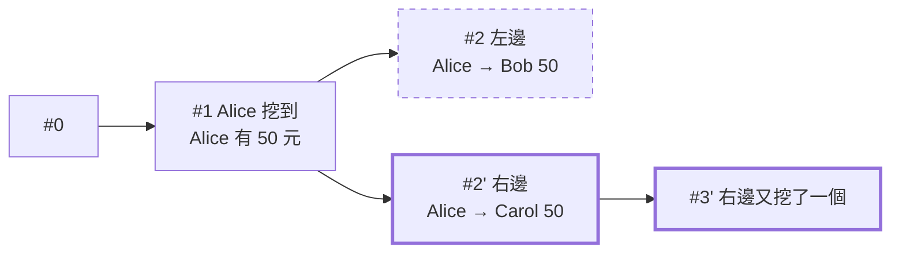

# 第 8 章：分岔和共識

網路有延遲，兩個礦工可能差不多同時挖到區塊；網路也可能斷成兩半。這時候不同節點會相信不同的鏈。這一章處理「大家意見不同時，聽誰的」。

- 程式：[`src/core/src/consensus.rs`](../../src/core/src/consensus.rs)、[`src/core/src/node.rs`](../../src/core/src/node.rs) 的 `replace_chain`
- 範例：`cargo run --example ch08-fork`
- 互動網頁：「網路和分岔」頁的「雙重支付示範」

## 分岔



網路斷成兩邊時，兩邊各自出塊，鏈就分岔（fork）了。重新接上之後，大家要同意同一條鏈。規則是：

> 相信**累積工作量**（total work）最多的鏈。

常聽到的「最長鏈原則」是這條規則的簡化版。區塊數一樣多，但難度比較高的鏈，背後花的計算比較多，比較難偽造，所以比的是工作量，不是區塊數。
累積工作量就是每個區塊的 `2^difficulty` 加起來（第 4 章的 `chain_work`）。一樣多的時候，留在自己這條（先看到的優先），等下一個區塊打破平手。

## 重組：被換掉的交易怎麼辦

換到另一條鏈叫**重組**（reorg）。被換掉的區塊裡的交易，如果新的鏈上沒有，要放回 mempool 等下一次出塊（`orphaned_transactions`）。
放回去之前會重新檢查，有些交易會因此被丟掉，例如錢已經在新的鏈上花掉了。

這就是上圖的雙重支付：Alice 在左邊付 50 元給 Bob，又在右邊把同一筆錢付給 Carol。右邊多挖了一個區塊，工作量比較多，大家都換到右邊。
付給 Bob 的交易被放回 mempool，但 Alice 的錢已經付給 Carol 了，這筆交易被丟掉。**Bob 以為收到的 50 元就這樣消失了。**

所以收款的人通常會等交易後面再多幾個區塊（確認數）才算數：要推翻越多區塊，攻擊者要做的工作量越大（第 4 章練習 2）。

## 看程式

收到整條鏈時（`Node::try_replace_chain`）：

1. 從創世區塊開始檢查每個區塊（雜湊、連結、難度、工作量證明）。
2. 累積工作量沒有比較多：不換。
3. 從頭重算帳本，每筆交易都要合法。
4. 找出分岔點，把舊鏈上被換掉、新鏈沒有的交易放回 mempool，重新檢查。
5. 換過去，記一筆 `ChainReplaced` 事件（被換掉幾筆交易、放回幾筆）。

> **跟 2018 年原本的專案比**：原本收到任何鏈的回應都會清空 pool，排隊中的交易就不見了；換鏈時也沒有把被換掉的交易放回去。
> 新版只拿掉已經上鏈的交易，被換掉的交易重新檢查後放回 mempool。

## 跑跑看

以下是輸出的節錄：

```console
$ cargo run --example ch08-fork
== 網路斷成兩邊：{0} 和 {1, 2} ==
左邊：Alice 付 50 給 Bob。右邊：Alice 付 50 給 Carol，而且右邊多挖了一個區塊。
節點 0：高度 2，最新 0001ef3c4e…，Bob 50 元，Carol 0 元
節點 1：高度 3，最新 0009f0e999…，Bob 0 元，Carol 50 元
節點 2：高度 3，最新 0009f0e999…，Bob 0 元，Carol 50 元

== 重新接上線 ==
節點 0  和節點 1 接上線
節點 0  換到工作量比較多的鏈：高度 2 → 3，從區塊 #2 開始不同；被換掉的區塊有 1 筆交易，0 筆重新放回 mempool
節點 0：高度 3，最新 0009f0e999…，Bob 0 元，Carol 50 元
```

在互動網頁按「雙重支付示範」，可以一步一步看到網路分成兩邊、各自出塊、重新接上後收斂。（礦工的金鑰每次都是新產生的，所以 hash 每次不一樣。）

## 動手做

**練習 1：** 攻擊者（節點 0）偷偷斷線，私下挖了 3 個區塊；其他人只挖了 1 個。重新接上後會怎樣？

<details>
<summary>解答</summary>

整個網路都換到攻擊者的鏈。這就是「51% 攻擊」的原理：誰的算力多，誰就能改寫最近的歷史。
所以工作量證明的安全性，建立在「誠實的礦工加起來的算力比攻擊者多」這個前提上。測試見 `a_private_longer_chain_takes_over`。

</details>

**練習 2：** 兩邊各挖一個區塊（一樣長、一樣難度），接上後誰贏？

<details>
<summary>解答</summary>

誰都沒贏：工作量一樣，各自留著先看到的那條。等其中一邊再挖到下一個區塊，工作量多了，另一邊才換過去。測試見 `a_tie_waits_for_the_next_block`。

</details>

解答和測試：[`src/core/tests/exercises.rs`](../../src/core/tests/exercises.rs)（`mod ch08`）。
另外 [`src/core/tests/scenarios.rs`](../../src/core/tests/scenarios.rs) 的 `a_shorter_chain_with_more_work_wins` 示範了「區塊比較少、但工作量比較多的鏈勝出」。

## 重點整理

- 分岔是正常的；規則是相信累積工作量最多、而且完全合法的鏈。
- 換鏈時，被換掉的交易放回 mempool 重新檢查；錢已經在新鏈上花掉的，就被丟掉。
- 交易後面的區塊越多，越難被推翻，所以收款要等確認數。

下一章：[第 9 章：FileChain](09-filechain.md)
