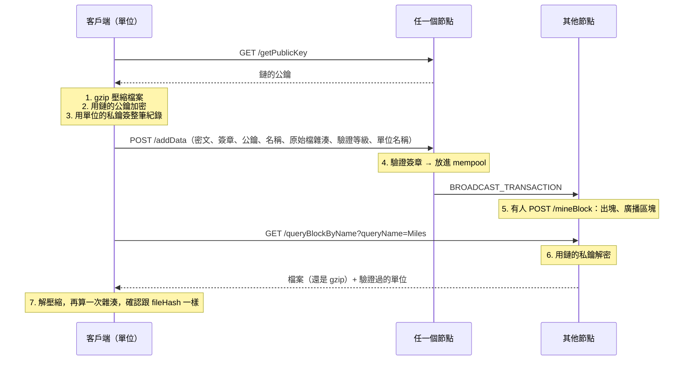

# 第 9 章：FileChain（檔案存證）

最後一章把前面學到的東西組起來，做出 2018 年原本專案的主角：**FileChain**。一個單位（例如某個機關）想證明「這個檔案在這個時間點存在，而且經過我們驗證」，就把檔案放上鏈。

- 程式：[`src/core/src/filechain.rs`](../../src/core/src/filechain.rs)
- 範例：`cargo run --example ch09-filechain`（全部在記憶體裡）、`cargo run -p chain-node --example ch09-client`（連到真的節點）
- 互動網頁：「FileChain」頁（原本 Django 網站的上傳、出塊、搜尋、顯示）

## 流程



用到的前幾章：雜湊（第 1 章，`fileHash`）、簽章（第 5 章）、mempool 和出塊（第 6 章）、P2P 廣播（第 7 章）。檔案紀錄是一種交易（`Transaction::File`），跟轉帳走同一套流程，只是不動到餘額。

## 加密：為什麼是 hybrid encryption

「用鏈的公鑰加密」有個問題：公鑰加密很慢，而且一次只能加密很短的資料（RSA 2048 一次只能加密兩百多 bytes）。所以實務上用**混合加密**（hybrid encryption）：

1. 先用公鑰的方法，談出一把只用一次的對稱金鑰。
2. 再用這把對稱金鑰加密整個檔案（對稱加密又快、長度又沒有限制）。

原本 2018 年的專案**已經是 hybrid**：用 RSA-OAEP 加密一把隨機的 16 bytes AES 金鑰，再用 AES-EAX 加密檔案。這次重寫保留這個架構，換成更新的做法：

| 步驟 | 2018 年原本的做法 | 現在 |
|---|---|---|
| 談出對稱金鑰 | RSA-OAEP（PyCryptodome 預設用 SHA-1）加密隨機 AES 金鑰 | X25519 金鑰交換 + HKDF-SHA256 |
| 加密檔案 | AES-128-EAX | AES-256-GCM |
| 密文格式 | RSA 密文 + nonce + tag + 密文 | 一次性公鑰（32 bytes）+ nonce（12 bytes）+ 密文和驗證碼 |
| 簽章 | RSA PKCS#1 v1.5 + SHA-1，只簽密文 | Ed25519，簽整筆紀錄 |

為什麼換：

- Rust 的 `rsa` crate 有一個還沒修好的時序攻擊公告（[RUSTSEC-2023-0071](https://rustsec.org/advisories/RUSTSEC-2023-0071)），解密時間會洩漏私鑰的資訊；節點正好要一直幫別人解密。X25519 的 crate（`x25519-dalek`）沒有這個問題。
- 在瀏覽器裡產生 RSA 金鑰要好幾秒，X25519 幾乎不用時間。
- GCM 和 EAX 一樣會附驗證碼：密文被改過一個 bit，解密就失敗，不會解出一堆亂碼。
- 簽整筆紀錄：原本只簽密文，名稱、雜湊、驗證等級在傳送途中都可以被改掉。

X25519 金鑰交換的意思是：客戶端產生一把一次性的金鑰，跟鏈的公鑰「交換」出一個共同秘密；鏈的私鑰加上那把一次性的公鑰，也能算出同一個秘密。
HKDF 再把這個秘密變成 AES 金鑰。整個 `seal`／`open` 用的都是維護中的 crate（`x25519-dalek`、`hkdf`、`aes-gcm`），沒有自己實作任何密碼學。

鏈的私鑰由節點**第一次啟動時產生**，存在 `data/` 或 docker 的 volume 裡，`.gitignore` 擋住，絕對不會 commit 進 git。docker compose 的 3 個節點共用同一把，跟原本「所有節點共用同一組金鑰檔」的設計一樣，所以從任何節點都查得到解密後的檔案。

## 查詢和驗證等級（cerLevel）

用名稱（`certificateOwner`）查詢時，規則跟原本的 `query_block_by_name` 一樣（`find_by_name`）：

1. 從最新的區塊、最新的紀錄往回找，名稱相同的才算。
2. 依原始檔的雜湊分組：內容一樣的檔案算同一個，列出驗證過的單位和次數。
3. 驗證等級（`cerLevel`）是 `Low`、`Medium`、`High` 時，每個等級只認**最新**那份檔案；同一個等級較舊的紀錄，只有在那份檔案已經在結果裡時才算進去。等級 `None` 的紀錄全部都算。

> **修正一個原本的 bug**：原本的程式第一次遇到某個等級時，會把那個檔案的單位清單整個重設，先前算到的單位就不見了。
> 例如 A 單位用 Low、B 單位用 Medium 驗證同一個檔案，原本只會列出 A。新版改成合併，回歸測試見 `first_seen_level_merges_instead_of_resetting`。

**單位名稱**：原本的程式把兩把公鑰寫死，對應到 `AMERICA` 和 `CHINA`。現在由單位在紀錄裡自己宣告名稱（`unitName`），而且簽章涵蓋這個名稱：
你看到的名稱，一定是那把公鑰的主人宣告的。但「這把公鑰真的是美國單位的嗎？」要靠別的方式確認，例如一份大家信任的名單，見練習 1。

## 跑跑看

```console
$ cargo run --example ch09-filechain
檔案：…/docs/images/samples/sample-certificate.png（23275 bytes，SHA-256 8e3cfa79892f06a5…）

== 1–3. 客戶端：壓縮、用鏈的公鑰加密、用單位的私鑰簽章 ==
AMERICA：上傳 28832 個 base64 字元，簽章 3a4ec0a577174e8c…
CHINA：上傳 28832 個 base64 字元，簽章 074e52312862bec4…
pool 裡有 2 筆（GET /poolList）

== 還沒出塊時查不到 ==
查 Miles：0 筆

== 6. 出塊（POST /mineBlock）==
區塊 #1 有 3 筆交易

== 7. 用名稱查詢（GET /queryBlockByName?queryName=Miles）==
檔案 8e3cfa79892f06a5…：還原 23275 bytes，跟原檔一樣：true
  - CHINA（Low）驗證 1 次
  - AMERICA（High）驗證 1 次
```

（金鑰每次都是新產生的，所以公鑰和簽章每次不一樣。）

連到真的節點，跑原本 notebook 的流程（上傳整個資料夾、看 pool、出塊、看鏈、用檔名查詢並還原）：

```console
$ docker compose up --build -d
$ cargo run -p chain-node --example ch09-client -- http://localhost:3001 docs/images/samples Low AMERICA
上傳 sample-certificate.png（23275 bytes）：HTTP 200 OK
上傳 sample-pattern.png（9788 bytes）：HTTP 200 OK
上傳 sample-sunrise.png（13975 bytes）：HTTP 200 OK

pool 裡有 3 筆
出塊：#1
鏈上有 2 個區塊

用檔名查詢，還原的檔案放在 /tmp/filechain-restored
sample-certificate.png：跟原檔一樣 true，驗證單位 AMERICA×1（Low）
sample-pattern.png：跟原檔一樣 true，驗證單位 AMERICA×1（Low）
sample-sunrise.png：跟原檔一樣 true，驗證單位 AMERICA×1（Low）
```

## 動手做

**練習 1：** 只相信名單上的單位。給一份「公鑰 → 單位名稱」的名單（就像原本程式寫死的 `loc_lookup`），不在名單上的單位不算，名稱以名單為準。

<details>
<summary>解答</summary>

<!-- solution -->
```rust
pub fn trusted_units(
    hits: &[FileHit],
    registry: &HashMap<String, String>,
) -> Vec<(String, u32)> {
    let mut counts: Vec<(String, u32)> = Vec::new();
    for certification in hits.iter().flat_map(|hit| &hit.certifications) {
        let Some(name) = registry.get(&certification.public_key) else {
            continue;
        };
        match counts.iter_mut().find(|(n, _)| n == name) {
            Some((_, count)) => *count += certification.count,
            None => counts.push((name.clone(), certification.count)),
        }
    }
    counts
}
```

測試裡有一個冒充者也宣告自己是 `AMERICA`，用名單過濾後只剩真的那一個。真實世界裡，這份名單通常由憑證機構或一群互相認識的單位維護。

</details>

**練習 2：** 有人在轉傳途中改了密文（`base64Data`）的一個字元。節點會收嗎？

<details>
<summary>解答</summary>

不會，`POST /addData` 回 400：簽章涵蓋整筆紀錄，密文改了，簽章就對不上（`TxError::BadSignature`）。
就算繞過簽章，AES-GCM 的驗證碼也會讓解密失敗。測試見 `tampered_upload_is_rejected`。

</details>

解答和測試：[`src/core/tests/exercises.rs`](../../src/core/tests/exercises.rs)（`mod ch09`）。

## 重點整理

- FileChain = 壓縮 + hybrid 加密 + 簽章 + 上鏈 + 依名稱查詢；檔案紀錄是一種交易。
- 2018 年的專案已經用 hybrid encryption；新版換成 X25519 + HKDF + AES-256-GCM，簽章改成簽整筆紀錄。
- 鏈的私鑰第一次啟動時產生，絕不進 git；網路裡的節點共用同一把。
- 查詢規則沿用原本的 cerLevel 邏輯，並修好了「單位清單被重設」的 bug。

回到 [README](../../README.md)，或看看 [跟 2018 年原本專案的對應](../original-project.md)。
